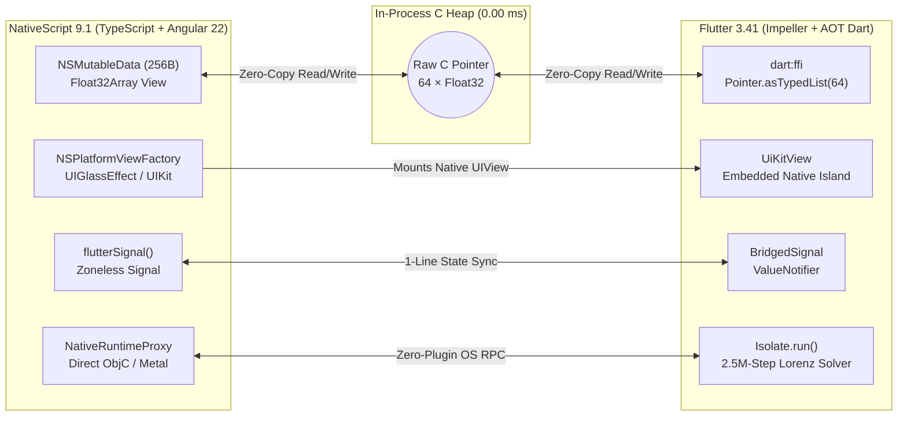

# NativeScript × Flutter Co-Processor

**Native OS Access. 120Hz GPU. Zero Native Plugins.**

An architectural showcase demonstrating how **NativeScript 9.1** (direct TypeScript access to 100% of iOS/Android OS APIs) and **Flutter 3.41** (120Hz Impeller GPU canvas + AOT ARM64 Dart `Isolate` compute) can operate together in the same process over a **256-byte zero-copy C pointer**—with **0 lines of Swift, Objective-C, Kotlin, or Java glue code**.

---

## Physical Footprint & Production Outcome

When evaluating a multi-engine architecture, the physical footprint and day-to-day engineering outcome matter more than anything else:

| Metric | Production Footprint | Engineering Outcome |
| :--- | :--- | :--- |
| **Shared Bridge RAM** | **`256 Bytes` (`64 × Float32`)** | Pinned `NSMutableData` C buffer mapped directly to `dart:ffi` `Pointer<Float>` — **0 bytes copied per frame**, **0 GC allocations**, **0.00 ms** serialization latency. |
| **Native Glue Code** | **`0 Swift / 0 Kotlin Files`** | Instantiate native iOS/Android views (`UIGlassEffect`, `CAMetalLayer`, `UIAlertController`) and `FlutterPlatformViewFactory` **100% in TypeScript** — zero native plugin targets or Podfiles to maintain. |
| **Release Binary Delta** | **`~7.2 MB` Compressed IPA** | Dart compiles ahead-of-time (`AOT`) to native ARM64 machine code (`App.framework`) alongside Impeller. |
| **OS UIKit & Metal** | **`0 KB` Binary Overhead** | Bound directly from the iOS `dyld_shared_cache` in-process via NativeScript metadata. |

---

## Architecture Overview



---

## Verify the Code in 10 Seconds

Every piece of this architecture lives in four small TypeScript files under [`src/flutter-bridge/`](./src/flutter-bridge) and a single Dart entry point in [`flutter_views/lib/main.dart`](./flutter_views/lib/main.dart):

### 1. 256-Byte Zero-Copy C-Heap Bridge (`NSMutableData` $\leftrightarrow$ `dart:ffi`)
- **TypeScript**: [`src/flutter-bridge/shared-memory.ts`](./src/flutter-bridge/shared-memory.ts)
- **Dart**: [`flutter_views/lib/main.dart`](./flutter_views/lib/main.dart)

```ts
// TypeScript (src/flutter-bridge/shared-memory.ts)
const nsData = NSMutableData.dataWithLength(256); // 64 × Float32 pinned in C heap
const address = interop.handleof(nsData.mutableBytes).toNumber();
const floats = new Float32Array(interop.bufferFromData(nsData));
floats[0] = 0.95; // Mutates physical RAM directly
```

```dart
// Dart (flutter_views/lib/main.dart)
final ptr = ffi.Pointer<ffi.Float>.fromAddress(rawAddress);
final Float32List shm = ptr.asTypedList(64); // Exact same 256 bytes in RAM
final drive = shm[0]; // 0 serialization, 0 GC allocations
```

---

### 2. Native UIKit Views Inside Flutter — Written 100% in TypeScript
Instead of writing a Swift/Objective-C `FlutterPlugin` to host a native iOS view inside Flutter's `UiKitView`, NativeScript implements `FlutterPlatformViewFactory` directly in TypeScript and returns a real iOS 26 `UIGlassEffect` / `UIVisualEffectView` containing native `UISegmentedControl`, `UISlider`, `UISwitch`, and `UIButton` controls:

- **TypeScript**: [`src/flutter-bridge/platform-view-factory.ts`](./src/flutter-bridge/platform-view-factory.ts)
- **Dart**: [`flutter_views/lib/main.dart`](./flutter_views/lib/main.dart)

```ts
// TypeScript (src/flutter-bridge/platform-view-factory.ts)
@NativeClass()
class NativeScriptPlatformViewFactory extends NSObject implements FlutterPlatformViewFactory {
  public static ObjCProtocols = [FlutterPlatformViewFactory];

  createWithFrameViewIdentifierArguments(frame: CGRect, viewId: number, args: any): FlutterPlatformView {
    return NativeLiquidGlassCardPlatformView.initWithFrameViewIdArgs(frame, viewId, args);
  }
}
```

```dart
// Dart (flutter_views/lib/main.dart)
UiKitView(
  viewType: 'nativescript-view',
  creationParams: const {'component': 'ios-liquid-glass-deck'},
  creationParamsCodec: const StandardMessageCodec(),
)
```

---

### 3. 1-Line Cross-Engine Reactive Signals (`flutterSignal<T>`)
Synchronize Angular 22 zoneless signals and Flutter `ValueNotifier<T>` instances across engines with automatic loop-prevention guards:

- **TypeScript**: [`src/flutter-bridge/flutter-signal.ts`](./src/flutter-bridge/flutter-signal.ts)
- **Component**: [`src/app/home.component.ts`](./src/app/home.component.ts)

```ts
// TypeScript (src/app/home.component.ts)
readonly morphMode = flutterSignal<number>('morphMode', 0);
this.morphMode.set(1); // Automatically updates Flutter ValueNotifier & UIKit UISegmentedControl
```

```dart
// Dart (flutter_views/lib/main.dart)
final morphMode = bridge.signal<int>('morphMode', 0);
ValueListenableBuilder<int>(
  valueListenable: morphMode,
  builder: (context, mode, _) => ...,
);
```

---

### 4. AOT Dart Isolates (`Isolate.run`) + Zero-Plugin Objective-C Reflection
Offload 2,500,000 steps of 3D Lorenz differential equation integration ($dx = \sigma(y-x),\, dy = x(\rho-z)-y,\, dz = xy - \beta z$) to a background Dart `Isolate` (~26 ms, >1B ops/sec) while reflecting live iOS Objective-C classes (`CAMetalLayer`, `UIVisualEffectView`, `FlutterViewController`) from Dart through NativeScript without a single native plugin:

- **TypeScript**: [`src/flutter-bridge/native-runtime-proxy.ts`](./src/flutter-bridge/native-runtime-proxy.ts)
- **Dart**: [`flutter_views/lib/main.dart`](./flutter_views/lib/main.dart)

```dart
// Dart (flutter_views/lib/main.dart)
final result = await Isolate.run(() => runParallelLorenzCompute(2500000));
final objcInfo = await bridge.invokeNative('objc.inspect', {'className': 'CAMetalLayer'});
```

---

## Quickstart

### Prerequisites
- macOS with Xcode & iOS Simulator installed
- Node.js 20+ and NativeScript CLI (`npm install -g nativescript`)
- Flutter SDK 3.24+ (`flutter --version`)

### Run on iOS Simulator
```bash
# 1. Install JavaScript dependencies
npm install

# 2. Fetch Flutter module packages
cd flutter_views && flutter pub get && cd ..

# 3. Launch on iOS Simulator
ns run ios
```
